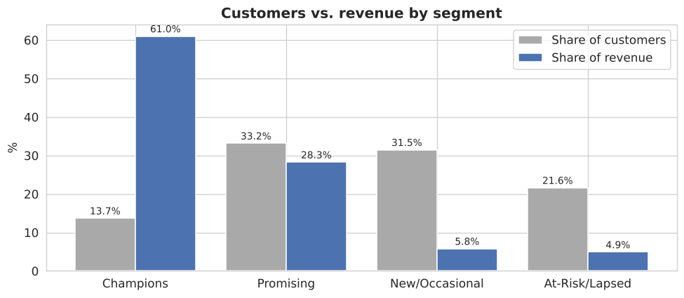
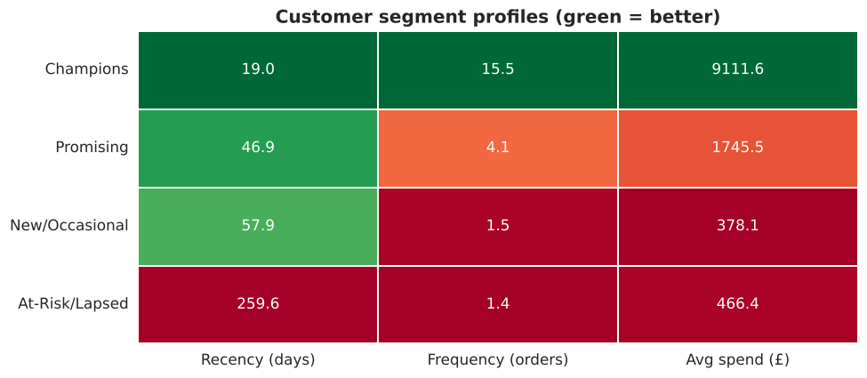
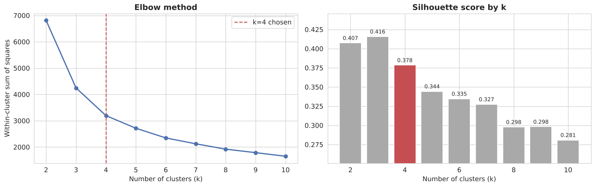
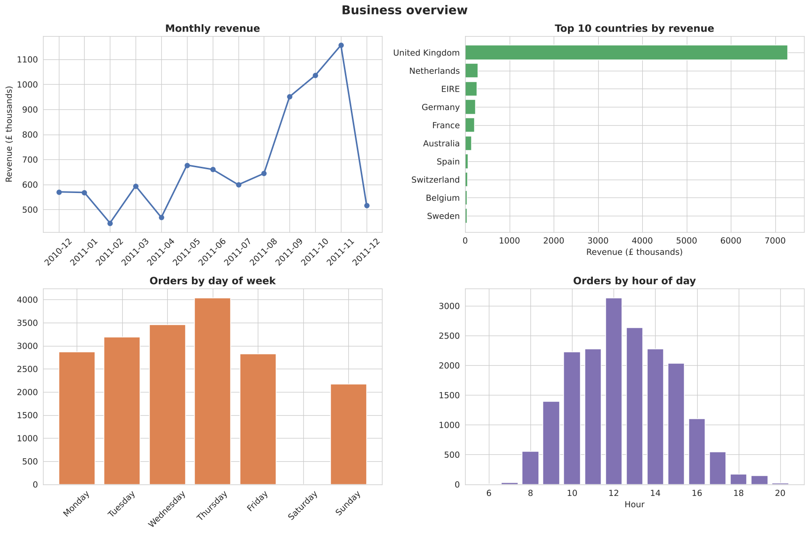

# Retail Customer Segmentation: RFM Analysis

Which customers drive an online retailer's revenue, which ones are growing, and which ones are slipping away? This project segments 4,338 customers of a UK online gift retailer by **Recency, Frequency and Monetary value (RFM)** and turns the segments into a retention and marketing plan.

## Key findings

- **13.7% of customers generate 61.0% of revenue.** These Champions buy every few weeks (15.5 orders on average) and spend far more than any other group, so retention matters more than acquisition.
- **Promising customers are the growth pipeline.** A third of the customer base, 28.3% of revenue. Moving 10% of them up to Champion-level spending is worth about **£436K**, based on median spend.
- **Two low-value groups need opposite actions.** New/Occasional and At-Risk/Lapsed customers both average about 1.5 orders. The difference is recency (58 vs. 260 days), so one group needs activation and the other a single win-back attempt.
- **Data quality issues are business signals too.** 98.9% of transactions without a customer ID come from the UK, which points to a checkout capture gap. Separating real customer returns from warehouse adjustments shows about 90% of negative-quantity rows are genuine returns.

## Segments

| Segment | Customers | Share of revenue | Avg recency | Avg orders | Median spend | Priority |
|---|---|---|---|---|---|---|
| Champions | 595 (13.7%) | 61.0% | 19 days | 15.5 | £4,332 | Retain |
| Promising | 1,439 (33.2%) | 28.3% | 47 days | 4.1 | £1,305 | Grow |
| New/Occasional | 1,366 (31.5%) | 5.8% | 58 days | 1.5 | £338 | Activate |
| At-Risk/Lapsed | 938 (21.6%) | 4.9% | 260 days | 1.4 | £294 | Win back once |

## Recommendations

- **Champions (retain):** VIP loyalty program, dedicated account management for the top 50 accounts, and loyalty rewards in September and October ahead of the Q4 peak. At stake: about £542K if 10% of Champions churn.
- **Promising (grow):** cross-sell based on purchase history, milestone rewards at the 5th, 10th and 15th order, and a re-engagement email after 45 days without an order.
- **New/Occasional (activate):** a post-purchase email sequence and a second-purchase offer within 30 days. Target: 25% second-purchase conversion within 60 days.
- **At-Risk/Lapsed (win back once):** one October campaign with a strong offer, then move the budget elsewhere if they don't respond. The ROI check is positive even in a conservative case (3.4x).
- **Budget split:** 40% retain, 30% grow, 20% activate, 10% win back, with campaign spend weighted toward September–November, since revenue peaks in November.
- **KPI to track monthly:** Net Segment Migration = (Promising → Champions) − (Champions → At-Risk/Lapsed). A negative number is an early warning of revenue decline.

## Approach

1. **Data quality assessment.** 541,909 transactions: 24.9% missing customer IDs, returns, cancellations, zero-price rows and duplicates.
2. **Data quality insights.** Separated customer returns from warehouse adjustments, and traced missing customer IDs by country.
3. **Cleaning.** Removed unidentified customers, returns, cancellations, zero prices and duplicates, leaving 392,692 transactions (72.5%) across 4,338 customers and 18,532 orders.
4. **Outlier analysis.** Wholesale orders inflate the average order value (£480 mean vs. £303 median), so medians are reported alongside means.
5. **RFM features.** Spend is capped at the 99th percentile for clustering only; all revenue figures use actual, uncapped spend.
6. **K-Means clustering** on log-transformed, scaled RFM features. k=4 was chosen using the elbow curve, silhouette scores and business usefulness: k=3 scores slightly higher (0.416 vs. 0.378) but merges recent one-time buyers with lapsed ones.
7. **Segment profiling and recommendations**, with tactics, KPIs and a win-back ROI check for each segment.

## Tools

Python (pandas, NumPy, scikit-learn, Matplotlib, seaborn), Jupyter

## Run it yourself

1. Download `data.csv` from the [E-Commerce Data dataset on Kaggle](https://www.kaggle.com/datasets/carrie1/ecommerce-data) (the UCI Online Retail dataset) and put it in a `data/` folder.
2. Install the requirements: `pip install -r requirements.txt`
3. Open `retail_rfm_segmentation.ipynb` and run all cells.

Exact cluster sizes can shift slightly between library versions; the pinned versions in `requirements.txt` reproduce the numbers above.
